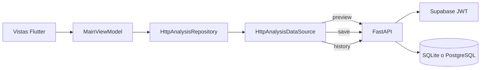
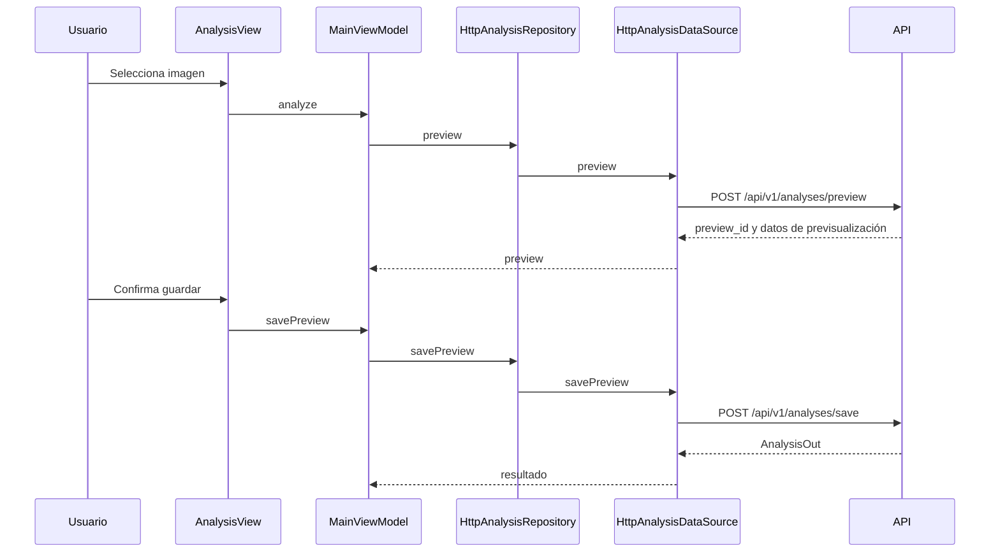
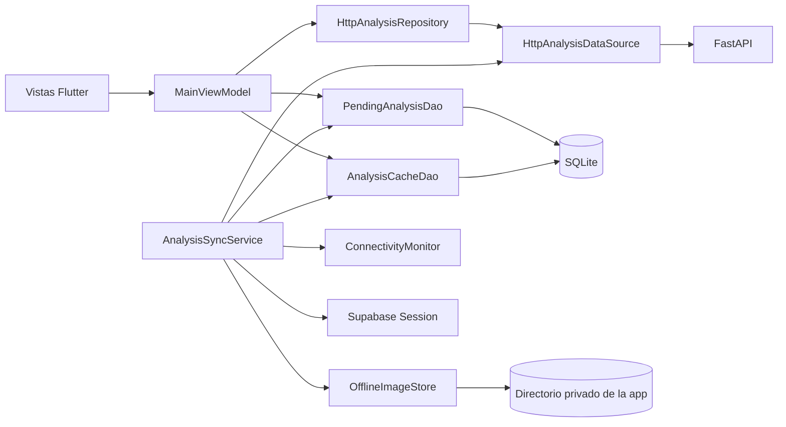
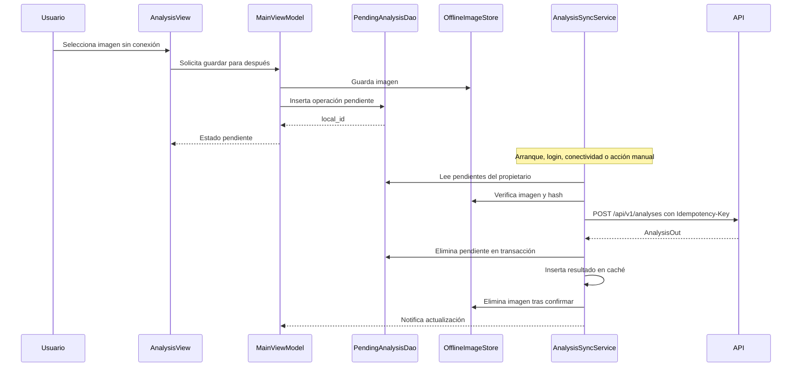
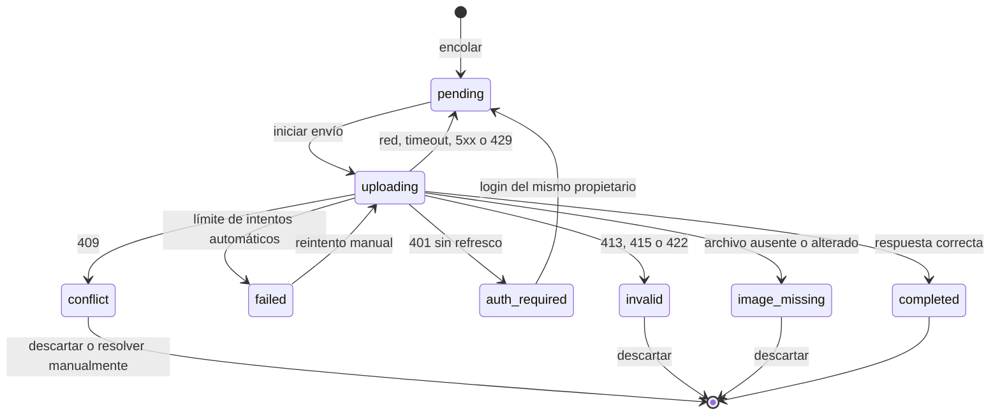

# Plan de implementación: modo offline

**Estado:** borrador técnico listo para implementación.
**Plataforma objetivo:** Flutter móvil, Android e iOS.
**Alcance:** permitir crear análisis sin conexión, conservarlos de forma durable, sincronizarlos con el backend y mostrarlos en el historial junto con los resultados ya descargados.

Este documento es una especificación. No contiene código de implementación y no propone modificar el flujo online `preview → save`.

---

## 1. Objetivo y alcance

### 1.1 Objetivo

Implementar un modo offline en la aplicación móvil que:

1. Permita seleccionar y guardar un análisis aunque no haya conectividad.
2. Persista la imagen, los metadatos y la intención de análisis en el dispositivo.
3. Envíe la operación al backend cuando exista una sesión válida y conectividad.
4. Evite duplicados mediante una `Idempotency-Key` estable.
5. Mantenga cada operación aislada por el UUID del propietario autenticado.
6. Muestre en el historial tanto los resultados descargados como los pendientes, con estados diferenciados.
7. No altere el comportamiento online actual de previsualización y guardado.

### 1.2 Incluido

- Persistencia local con SQLite.
- Cola de análisis pendientes.
- Caché local de resultados remotos.
- Almacenamiento privado de imágenes.
- Sincronización automática y manual.
- Manejo de errores, reintentos y backoff.
- Aislamiento estricto por cuenta.
- Historial offline con estados de pendiente.
- Pruebas unitarias, de persistencia, integración y regresión.

### 1.3 Excluido de la v1

- Ejecución en segundo plano con la aplicación cerrada.
- Inferencia local o modelo en el dispositivo.
- Soporte web o arquitectura IndexedDB.
- Nuevos endpoints de backend.
- Sustitución o eliminación del flujo online `preview → save`.
- Sincronización entre dispositivos.
- Edición o reprocesamiento de análisis ya guardados.

### 1.4 Definiciones

| Término | Significado |
|---|---|
| Propietario | UUID del usuario autenticado en Supabase Auth, tomado de `sub`. |
| Operación pendiente | Análisis creado localmente que aún no tiene un resultado remoto confirmado. |
| Resultado cacheado | `AnalysisOut` descargado del backend y guardado localmente para consulta offline. |
| Clave de idempotencia | UUID generado una vez al encolar y reutilizado en todos los reintentos. |
| Contenido congelado | Imagen y metadatos asociados a la operación en el momento de encolarla. |
| Sesión válida | Sesión cuyo UUID coincide con el propietario de la operación y cuyo token puede usarse. |

---

## 2. Arquitectura actual y objetivo

### 2.1 Arquitectura actual

La app Flutter usa una arquitectura por capas:

- Vistas y `MainViewModel` para estado y acciones.
- `HttpAnalysisRepository` como implementación de repositorio.
- `HttpAnalysisDataSource` como cliente HTTP.
- Supabase Auth para la sesión.
- Backend FastAPI para inferencia, preview, guardado e historial.

Flujo online actual:

Hechos relevantes del estado actual:

- El flujo remoto de la UI usa `preview → save`.
- El endpoint directo `POST /api/v1/analyses` ya existe, pero no es el camino actual de la UI.
- `main.dart` obtiene la sesión, refresca el token si expiró y pasa el `accessToken` al datasource.
- `HttpAnalysisDataSource` añade `Authorization: Bearer <token>`.
- El backend obtiene `account_id` exclusivamente del `sub` verificado.
- El backend ya aplica idempotencia con unicidad `(account_id, idempotency_key)`.
- El backend ya aísla historial y detalle por `account_id`.
- Flutter solo usa `shared_preferences` para apariencia, orden de historial y sesión mock.
- No existe base de datos local, caché de historial ni cola de operaciones.
- Las imágenes viven en memoria; la app no conserva una ruta propia al archivo original.
- `Account` solo contiene nombre y email; el UUID del usuario no se conserva.
- Al cerrar sesión se limpian las imágenes y los análisis en memoria.
- El historial se consulta siempre al backend; tras reiniciar no hay historial offline.
- Los errores HTTP se transforman en fallos genéricos; no existe una política común de reintentos.
- La app no registra errores tipados por código ni distingue reintentables de terminales.

### 2.2 Arquitectura objetivo

Principios:

1. El servidor sigue siendo la fuente de verdad de los resultados.
2. La caché local es una copia de lectura, no una segunda fuente de verdad.
3. Toda operación está vinculada a un propietario desde su creación.
4. No se envía una operación con un token de otra cuenta.
5. La clave de idempotencia se genera una vez y no se regenera.
6. El flujo online existente no se modifica ni se sustituye.
7. Los pendientes no se presentan como resultados médicos definitivos.
8. No se persisten tokens ni secretos en la base local.

### 2.3 Flujo offline objetivo

---

## 3. Modelo de datos local

La base local debe ser SQLite mediante `sqflite`. Las rutas de imágenes se guardan relativas al directorio privado de la aplicación, nunca como rutas absolutas dependientes del sistema operativo.

### 3.1 Tabla `pending_analyses`

Representa operaciones creadas localmente que aún no tienen resultado remoto confirmado.

| Campo | Tipo | Nulo | Propósito |
|---|---|---|---|
| `local_id` | TEXT | No | UUID local de la operación. Clave primaria. |
| `owner_id` | TEXT | No | UUID de Supabase del propietario. |
| `idempotency_key` | TEXT | No | UUID enviado al backend; estable durante toda la vida de la operación. |
| `display_name` | TEXT | Sí | Nombre normalizado; vacío se guarda como nulo. |
| `image_path` | TEXT | No | Ruta relativa dentro del directorio privado. |
| `image_mime` | TEXT | No | Tipo MIME validado. |
| `image_size` | INTEGER | No | Tamaño en bytes. |
| `image_sha256` | TEXT | No | Hash para detectar archivos ausentes o alterados. |
| `status` | TEXT | No | `pending`, `uploading`, `failed`, `conflict`, `auth_required`, `image_missing` o `invalid`. |
| `attempts` | INTEGER | No | Número de intentos automáticos realizados. |
| `last_error_code` | TEXT | Sí | Código normalizado del último error. |
| `last_error_message` | TEXT | Sí | Mensaje seguro para la UI; sin datos sensibles. |
| `next_retry_at` | INTEGER | Sí | Época en milisegundos; nulo si no aplica. |
| `created_at` | INTEGER | No | Época en milisegundos de creación local. |
| `updated_at` | INTEGER | No | Época en milisegundos de última modificación. |

Restricciones e índices:

- Clave primaria: `local_id`.
- Unicidad: `(owner_id, idempotency_key)`.
- Índice: `(owner_id, status, next_retry_at)`.
- Índice: `(owner_id, created_at)`.

### 3.2 Tabla `cached_analyses`

Representa resultados remotos descargados y disponibles para lectura offline.

| Campo | Tipo | Nulo | Propósito |
|---|---|---|---|
| `owner_id` | TEXT | No | UUID del propietario. |
| `remote_id` | TEXT | No | Identificador remoto del análisis. |
| `category` | TEXT | No | Categoría del resultado. |
| `created_at` | INTEGER | No | Fecha del servidor en milisegundos. |
| `display_name` | TEXT | Sí | Nombre mostrado. |
| `probability` | REAL | Sí | Probabilidad principal. |
| `scores_json` | TEXT | No | Puntuaciones serializadas. |
| `is_demo` | INTEGER | No | Indicador booleano almacenado como 0/1. |
| `model_name` | TEXT | Sí | Nombre del modelo. |
| `model_version` | TEXT | Sí | Versión del modelo. |
| `model_dataset` | TEXT | Sí | Dataset del modelo. |
| `synced_at` | INTEGER | No | Última sincronización local. |

Restricciones e índices:

- Clave primaria compuesta: `(owner_id, remote_id)`.
- Índice: `(owner_id, created_at DESC)`.

### 3.3 Tabla `sync_state`

Estado de sincronización por propietario.

| Campo | Tipo | Nulo | Propósito |
|---|---|---|---|
| `owner_id` | TEXT | No | UUID del propietario. Clave primaria. |
| `last_history_sync_at` | INTEGER | Sí | Última consulta completa de historial. |
| `last_queue_sync_at` | INTEGER | Sí | Última ejecución de la cola. |
| `last_history_error` | TEXT | Sí | Último error seguro de historial. |
| `last_queue_error` | TEXT | Sí | Último error seguro de cola. |
| `updated_at` | INTEGER | No | Última actualización del registro. |

### 3.4 Relaciones e invariantes

- No hay claves foráneas físicas entre propietarios; el aislamiento se garantiza filtrando siempre por `owner_id`.
- Un pendiente no puede convertirse en resultado cacheado sin una respuesta remota válida.
- Un resultado cacheado y un pendiente del mismo propietario pueden coexistir solo si representan operaciones distintas.
- La clave de idempotencia no se comparte entre propietarios.
- El contenido congelado de un pendiente no cambia después de crearlo.
- Un pendiente en estado `uploading` que queda huérfano por cierre de la app se recupera al arrancar y vuelve a `pending`, conservando la misma clave.

### 3.5 Transacciones

**Encolar una operación:**

1. Validar imagen y metadatos.
2. Escribir la imagen en un archivo temporal.
3. Renombrar el archivo temporal al nombre definitivo.
4. Insertar la fila en `pending_analyses`.
5. Si la inserción falla, eliminar el archivo definitivo.
6. Si la escritura de imagen falla, no insertar la fila.

**Completar una operación:**

1. Insertar o actualizar el resultado en `cached_analyses`.
2. Eliminar la fila de `pending_analyses`.
3. Confirmar la transacción.
4. Eliminar la imagen asociada.
5. Si falla la eliminación de la imagen, dejarla para la limpieza de huérfanos.

**Descartar una operación:**

1. Eliminar la fila de `pending_analyses`.
2. Eliminar la imagen asociada.
3. Si la imagen no existe, completar sin error.

**Sincronizar historial:**

1. Descargar todas las páginas.
2. Hacer upsert de los resultados del propietario.
3. Purgar únicamente los resultados remotos ausentes.
4. Actualizar `last_history_sync_at`.
5. No tocar pendientes.

---

## 4. Almacenamiento de imágenes

### 4.1 Ubicación

- Usar el directorio de soporte de la aplicación mediante `path_provider`.
- Crear un subdirectorio por propietario: `analyses/<owner_id>/`.
- Guardar en la base solo la ruta relativa.
- No usar rutas absolutas ni rutas de la galería.
- No depender del archivo original elegido por el usuario.

### 4.2 Escritura

- Guardar los bytes recibidos de `SelectedImage.bytes`.
- Mantener la validación actual: JPG/JPEG/PNG, máximo 10 MB y decodificación válida.
- Escribir primero en un archivo temporal dentro del mismo directorio.
- Renombrar al nombre definitivo `<local_id>.<ext>` solo cuando la escritura termine.
- Calcular SHA-256 después de escribir y antes de insertar en la base.
- Si la app se cierra durante la escritura, el archivo temporal se considera huérfano y se limpia al arrancar.

### 4.3 Lectura y envío

Antes de enviar una operación:

1. Verificar que el archivo existe.
2. Verificar que el tamaño coincide.
3. Verificar que el hash coincide.
4. Verificar que el MIME sigue siendo válido.

Si el archivo no existe: estado `image_missing`, sin reintento automático.
Si el hash o el tamaño no coinciden: estado `invalid`, sin reintento automático.
Si el archivo se puede leer: enviar exactamente el contenido congelado.

### 4.4 Eliminación y retención

- Al completar con éxito: eliminar la imagen después de confirmar la transacción de caché.
- Al descartar: eliminar la imagen junto con la fila pendiente.
- Al perder la sesión: no eliminar automáticamente la imagen; la operación sigue perteneciendo a su propietario.
- Al arrancar: eliminar archivos temporales y archivos sin fila pendiente asociada.
- La retención de imágenes de resultados ya cacheados depende de si el detalle o el PDF offline las necesitan. Debe verificarse en la fase 0.
- Recomendación inicial: conservar imágenes solo mientras exista un pendiente; si el PDF offline no las necesita, eliminarlas al completar.
- Añadir un límite de almacenamiento y una acción de limpieza; los valores concretos quedan como decisión pendiente.

### 4.5 Privacidad

- El directorio debe ser privado de la aplicación, no la galería.
- No registrar imágenes, rutas completas ni contenido en logs.
- No incluir tokens en la base local.
- Evaluar cifrado en reposo y exclusión de backup en iOS antes de producción.
- Actualizar los textos de privacidad que hoy indican que la imagen no está disponible después de cerrar la app.

---

## 5. Sincronización y autenticación

### 5.1 Disparadores

| Disparador | Acción |
|---|---|
| Arranque con sesión restaurada | Recuperar `uploading` huérfanos, procesar cola y refrescar historial si corresponde. |
| Login correcto | Cargar caché del propietario y procesar su cola. |
| Recuperación de conectividad | Procesar cola y refrescar historial. |
| Acción manual del usuario | Ejecutar sincronización sin esperar el backoff, salvo errores terminales. |
| App vuelve a primer plano | Reanudar si hay pendientes o la caché está desactualizada. |
| Cierre de sesión | Cancelar sincronización y no enviar más operaciones. |

No se ejecuta sincronización con la app cerrada.

### 5.2 Propietario y sesión

- Al encolar, capturar el UUID del propietario.
- Antes de enviar, comprobar que el UUID de la sesión actual coincide con el propietario de la operación.
- Si no coincide, pausar la operación y no enviarla.
- Nunca usar el token de la cuenta activa para una operación de otra cuenta.
- Obtener el token de la sesión actual; refrescarlo si está expirado.
- No persistir el token en SQLite ni en `shared_preferences`.

### 5.3 Errores de autenticación

- Ante `401`: intentar refrescar la sesión y reintentar una vez.
- Si el refresco falla: marcar `auth_required` y pausar la cola.
- Tras un login correcto del mismo propietario: devolver `auth_required` a `pending` y reanudar.
- Si el login es de otro propietario: no reanudar operaciones ajenas; cargar solo su propia cola y caché.
- Si el backend devuelve `403`: pausar y mostrar error de autorización.

### 5.4 Cambio de cuenta y cierre de sesión

- Cancelar cualquier sincronización en curso.
- Invalidar la versión de sesión en memoria.
- No actualizar la UI con resultados de la cuenta anterior.
- Cargar la caché del nuevo propietario.
- Las operaciones de la cuenta anterior permanecen aisladas por `owner_id`.
- La decisión de conservar o borrar la caché al cerrar sesión queda pendiente; en ambos casos está prohibido mostrarla a otra cuenta.

### 5.5 Concurrencia

- Usar un mutex de sincronización para evitar dos ejecuciones simultáneas.
- Procesar una operación a la vez por propietario.
- No marcar dos veces la misma operación como `uploading`.
- Antes de subir, comprobar el estado actual en la base.
- Si la app se cierra durante `uploading`, al arrancar se vuelve a `pending` y se reenvía con la misma clave.

### 5.6 Resultados tardíos

- Una respuesta que llega después de un cierre de sesión se escribe en la caché del propietario capturado al encolar.
- Solo se actualiza la UI si el propietario activo y la versión de sesión siguen coincidiendo.
- Un resultado tardío nunca debe aparecer en el historial de otra cuenta.

### 5.7 Modo mock

- En modo mock no existe UUID real de Supabase.
- Recomendación: deshabilitar la cola offline en modo mock o limitarla a un propietario local ficticio claramente identificado.
- No mezclar datos mock con datos reales.

---

## 6. Integración con el backend

### 6.1 Endpoint utilizado

La sincronización offline usa el endpoint directo existente:

- Método: `POST`.
- Ruta: `/api/v1/analyses`.
- Cuerpo: multipart con `file` y `display_name`.
- Cabecera: `Idempotency-Key`.
- Autenticación: `Authorization: Bearer <token>`.
- Respuesta: `AnalysisOut`.

No se usan `preview` ni `save` para operaciones offline.

### 6.2 Construcción de la solicitud

- Reutilizar `HttpAnalysisDataSource.analyze` con un `SelectedImage` construido desde el archivo persistido.
- Normalizar `display_name`: recortar espacios; si queda vacío, enviar nulo; limitar a 120 caracteres.
- Usar la `Idempotency-Key` persistida, no una nueva.
- Enviar exactamente los bytes y metadatos congelados.
- No modificar el contenido después del primer intento.
- No enviar campos adicionales que el backend no espere.

### 6.3 Compatibilidad de la respuesta

La respuesta de `POST /api/v1/analyses` es un `AnalysisOut`. Debe alimentar el mismo camino que ya usan el historial, el detalle y el PDF.

| Campo de `AnalysisOut` | Consumidor actual | Observación |
|---|---|---|
| `id` | `AnalysisResultDto` → `AnalysisResult` | Identificador remoto; clave de caché junto al propietario. |
| `category` | DTO, detalle, PDF | Compatible. |
| `created_at` | DTO, orden de historial | Usar la fecha del servidor; no sustituirla por la fecha local. |
| `display_name` | DTO, historial, detalle, PDF | Puede ser nulo; normalizar antes de encolar. |
| `probability` | Detalle, PDF | Compatible. |
| `scores` | Detalle, PDF | Compatible. |
| `is_demo` | DTO y vistas | Compatible. |
| `model.name` | DTO | Compatible. |
| `model.version` | DTO | Puede diferir entre respuesta directa y resumen de historial; es un comportamiento existente. |
| `model.dataset` | DTO | Compatible. |

`AnalysisResultDto` ya tolera el objeto `model` y el formato plano con `model_name`. La respuesta del endpoint directo puede reutilizar el mismo DTO sin cambios de backend.

Conclusión: no se requiere modificar `AnalysisOut`, el endpoint directo ni los consumidores. Sí se requiere una prueba de contrato que demuestre que una respuesta real de `POST /api/v1/analyses` se parsea y se muestra igual en historial, detalle y PDF.

### 6.4 Actualización de caché e historial

Al recibir una respuesta correcta:

1. Verificar que el propietario capturado coincide con el propietario de la sesión usada.
2. Insertar o actualizar el resultado en `cached_analyses` con la clave `(owner_id, id)`.
3. Eliminar la fila de `pending_analyses` y su imagen en la misma operación lógica.
4. Actualizar la UI solo si el propietario activo sigue siendo el mismo y la versión de sesión no cambió.
5. Si la respuesta se perdió pero el servidor la procesó, el reintento con la misma clave y el mismo contenido debe devolver el resultado almacenado.

Tras una consulta completa de historial:

- Recorrer todas las páginas con `limit=100` y `offset` hasta recibir menos de 100.
- Hacer upsert de todos los resultados del propietario.
- Purgar de la caché local solo los resultados remotos ausentes, y solo después de una consulta completa y correcta.
- No purgar pendientes.
- No mezclar resultados de propietarios distintos.

La caché nunca debe contener un pendiente presentado como `AnalysisResult`.

### 6.5 Mantener `preview → save`

- El flujo online actual no se elimina ni se sustituye.
- `preview` sigue creando la previsualización.
- `save` sigue guardando con `save_proof`.
- El modo offline usa exclusivamente el endpoint directo.
- Un fallo de `save` no se convierte automáticamente en un `POST /analyses`; el `save` pudo haber llegado al servidor y se crearía un duplicado.
- Si falla `save` por red, se reintenta `save` con el mismo `save_proof` mientras sea válido.
- Si la app se cierra durante ese intervalo, el `save_proof` en memoria se pierde. En v1 esto obliga a repetir el análisis; persistir el proof para reanudar el `save` es una decisión pendiente.
- Si se pierde la respuesta de `preview`, se genera una nueva previsualización. Guardar ambas produciría un duplicado; no se debe automatizar ese camino.

### 6.6 Cambios de backend

No se requieren cambios de backend para la v1:

- Ya existe `POST /api/v1/analyses`.
- Ya acepta `Idempotency-Key`.
- Ya deriva `account_id` del `sub` verificado.
- Ya existe unicidad `(account_id, idempotency_key)`.
- Ya existen listado, detalle, preview y save.
- No hace falta un endpoint de sincronización por lote; la cola puede enviar operaciones individuales.

Si durante la implementación aparece una necesidad real, debe documentarse y justificarse antes de tocar backend.

---

## 7. Idempotencia y política de errores

### 7.1 Identidad de la operación

- Generar una `Idempotency-Key` UUID v4 al crear la operación local.
- Persistirla antes de cualquier envío.
- Congelar el contenido: bytes de la imagen, nombre normalizado y metadatos relevantes.
- Reutilizar la misma clave en todos los reintentos.
- Nunca regenerar la clave tras un timeout, una respuesta perdida o un `409`.
- Calcular un hash local del contenido para detectar cambios o archivos corruptos.

### 7.2 Máquina de estados

Un pendiente completado deja de existir en `pending_analyses`; su resultado pasa a `cached_analyses`.

### 7.3 Tabla de errores

| Situación | Tratamiento | Reintento automático |
|---|---|---|
| Sin red, timeout, error de conexión | Mantener pendiente; aplicar backoff | Sí |
| `401` | Pausar la cola, intentar refrescar la sesión; si falla, marcar `auth_required` | No hasta recuperar sesión |
| `403` | Pausar y marcar error de autorización | No |
| `409` | Marcar `conflict`; no generar clave nueva; refrescar historial; intervención del usuario | No |
| `413`, `415`, `422` | Marcar `invalid`; mostrar causa; permitir descartar | No |
| `429` | Respetar `Retry-After`; backoff | Sí |
| `500` | Backoff | Sí |
| `503` | Respetar `Retry-After`; backoff; puede ser modelo no disponible | Sí |
| Archivo local ausente o hash distinto | Marcar `image_missing`; no enviar | No |
| Error de escritura o lectura local | Pausar la operación; no borrar la imagen | No |

### 7.4 Backoff

- Base: `5 s * 2^intentos`.
- Tope: 15 minutos.
- Añadir jitter para evitar ráfagas.
- Guardar `attempts`, `last_error_code`, `last_error_message` y `next_retry_at`.
- La sincronización manual puede saltarse la espera, pero no los errores terminales.
- Recomendación: tras 5 intentos automáticos, marcar `failed` y permitir reintento manual.

### 7.5 Reglas de autenticación

- Cada operación guarda el UUID del propietario que la creó.
- Antes de enviar, comprobar que la sesión actual pertenece a ese mismo UUID.
- Si no coincide, no enviar; pausar la operación.
- Nunca usar el token de otra cuenta para vaciar la cola.
- No persistir tokens de acceso en la base local; la sesión la gestiona Supabase.
- No registrar cuerpos de imagen ni tokens.

### 7.6 Conflictos

- Un `409` significa que la clave ya existe con contenido distinto o que el backend no puede resolver la idempotencia.
- No se debe generar una clave nueva para “saltarse” el conflicto.
- El pendiente se marca `conflict` y se deja al usuario la decisión de descartarlo o revisar el historial.
- No se debe reintentar automáticamente con otro contenido.

---

## 8. Historial offline

### 8.1 Composición de la vista

El historial debe mostrar:

1. Resultados descargados desde el backend, leídos de `cached_analyses`.
2. Operaciones pendientes, leídas de `pending_analyses`, en una sección diferenciada.

Los pendientes muestran estados como `pendiente`, `subiendo`, `fallido`, `conflicto`, `requiere sesión`, `imagen ausente` o `inválido`. No deben abrir detalle ni generar PDF.

### 8.2 Consulta y actualización

- Filtrar siempre por `owner_id`.
- Ordenar los resultados por `created_at` descendente.
- Mantener los pendientes separados del orden y de los filtros de `SortHistory` para no modificar ese modelo.
- Tras sincronizar con éxito, mover el pendiente a la caché y refrescar la lista.
- Tras una consulta remota completa, hacer upsert y purgar solo lo ausente del propietario.
- Si el usuario cambia de cuenta, cargar la caché del nuevo propietario y no mostrar nada del anterior.

### 8.3 Resultados tardíos

Una respuesta que llega después de un logout debe escribirse en la caché del propietario capturado al encolar, no en la UI activa. Solo se actualiza la UI si el propietario activo y la versión de sesión siguen coincidiendo.

### 8.4 Acciones del usuario

- Reintentar un pendiente fallido.
- Descartar un pendiente y borrar su imagen.
- Sincronizar manualmente.
- Consultar el detalle y generar PDF solo para resultados cacheados o remotos.
- Ver el motivo de un error terminal.

---

## 9. Plan de implementación por fases

Las fases son incrementales y cada una debe dejar el proyecto compilando y con pruebas verdes.

### Fase 0 — Contrato y línea base

**Objetivo:** demostrar que el endpoint directo es compatible antes de construir la cola.

- Archivos a crear: pruebas de contrato en `frontend/test/contracts/`; pruebas de regresión del flujo actual.
- Archivos a modificar: ninguno de producción.
- Cambios: prueba de parseo de `AnalysisOut` con `AnalysisResultDto`; prueba del flujo `preview → save`; documentación de comandos de análisis y pruebas.
- Dependencias: ninguna nueva.
- Pruebas: parseo de todos los campos; historial, detalle y PDF con una respuesta directa; `save` exitoso.
- Criterio de aceptación: las pruebas pasan sin cambios de producción.
- Dependencias: ninguna.

### Fase 1 — Identidad y dominio

**Objetivo:** disponer de un UUID de propietario estable.

- Archivos a modificar: `frontend/lib/domain/models/account.dart`, `frontend/lib/data/datasources/supabase_account_data_source.dart`, `frontend/lib/main.dart`, `frontend/lib/app/app_dependencies.dart`, `frontend/lib/presentation/viewmodels/main_view_model.dart`.
- Cambios: añadir `id` a `Account`; mapear `user.id`; propagar el propietario; comparar sesiones por UUID y no solo por email; definir `null` en modo mock.
- Dependencias: ninguna nueva.
- Pruebas: mapeo de usuario; cambio A/B; sesión mock sin UUID.
- Criterio de aceptación: el propietario está disponible y no se confunde por email.
- Dependencias: fase 0.

### Fase 2 — Persistencia local e imágenes

**Objetivo:** guardar cola, caché e imágenes de forma durable.

- Archivos a crear: `frontend/lib/data/local/app_database.dart`, `frontend/lib/data/local/analysis_cache_dao.dart`, `frontend/lib/data/local/pending_analysis_dao.dart`, `frontend/lib/data/local/sync_state_dao.dart`, `frontend/lib/data/local/offline_image_store.dart`.
- Archivos a modificar: `frontend/lib/app/app_dependencies.dart`, `frontend/pubspec.yaml`.
- Cambios: crear esquema SQLite, versionado y migraciones; DAOs con transacciones; almacén de imágenes en directorio privado con nombres relativos; escritura temporal y renombrado.
- Dependencias: `sqflite`, `path_provider`; desarrollo: `sqflite_common_ffi`.
- Pruebas: CRUD, unicidad, transacciones, persistencia tras reinicio, archivo ausente.
- Criterio de aceptación: una operación y su imagen sobreviven al cierre de la app.
- Dependencias: fase 1.

### Fase 3 — Errores tipados y política de reintentos

**Objetivo:** distinguir errores reintentables, terminales y de autenticación.

- Archivos a modificar: `frontend/lib/data/datasources/http_analysis_data_source.dart`.
- Archivos a crear: modelo de error propuesto en `frontend/lib/data/errors/`.
- Cambios: interpretar códigos HTTP, `Retry-After` y errores de red; no reintentar dentro del datasource; exponer metadatos suficientes al sincronizador.
- Dependencias: ninguna nueva.
- Pruebas: `401`, `409`, `413`, `415`, `422`, `429`, `503`, timeout y error de conexión.
- Criterio de aceptación: cada error produce la acción correcta sin ambigüedad.
- Dependencias: fase 2.

### Fase 4 — Cola y sincronización

**Objetivo:** enviar pendientes con idempotencia y sin cruzar cuentas.

- Archivos a crear: `frontend/lib/services/analysis_sync_service.dart`, `frontend/lib/services/connectivity_monitor.dart`.
- Archivos a modificar: `frontend/lib/app/app_dependencies.dart`, `frontend/lib/main.dart`, `frontend/lib/presentation/viewmodels/main_view_model.dart`, `frontend/lib/presentation/views/analysis_view.dart`.
- Cambios: crear operación al encolar; congelar contenido; procesar una operación por propietario; mutex contra sincronizaciones concurrentes; disparadores al arrancar, tras login, al recuperar conectividad, manual y al volver a primer plano; cancelar al cambiar de cuenta.
- Dependencias: `connectivity_plus`.
- Pruebas: reintento con misma clave, respuesta perdida, `409`, `401`, cambio A/B, sincronización concurrente.
- Criterio de aceptación: no se duplican análisis y nunca se envía con la sesión equivocada.
- Dependencias: fase 3.

### Fase 5 — Historial offline y UI

**Objetivo:** mostrar caché y pendientes con estados claros.

- Archivos a modificar: `frontend/lib/presentation/viewmodels/main_view_model.dart`, `frontend/lib/presentation/views/home_view.dart`, `frontend/lib/presentation/views/history_view.dart`, `frontend/lib/presentation/widgets/history_status.dart`.
- Archivos a crear: widget de pendientes propuesto en `frontend/lib/presentation/widgets/`.
- Cambios: estado combinado; sección de pendientes; acciones de reintentar y descartar; refresco tras sincronización; bloquear detalle y PDF de pendientes.
- Dependencias: ninguna nueva.
- Pruebas: historial con caché, con pendientes, mixto, cambio de cuenta y resultado tardío.
- Criterio de aceptación: el usuario entiende qué está guardado y qué está pendiente.
- Dependencias: fase 4.

### Fase 6 — Recuperación, privacidad y limpieza

**Objetivo:** cerrar huecos de durabilidad y privacidad.

- Archivos a modificar: almacén de imágenes, arranque de la app, `frontend/lib/presentation/views/profile_view.dart`, `frontend/ARCHITECTURE.md`, `frontend/API_SETUP.md`, `frontend/SUPABASE_SETUP.md`, `frontend/README.md`.
- Cambios: recuperar operaciones `uploading`; limpiar huérfanos; tratar imágenes ausentes; definir retención; actualizar textos de privacidad; decidir cifrado y backup iOS.
- Dependencias: ninguna nueva.
- Pruebas: cierre a mitad de subida, archivo borrado, arranque con cola, limpieza.
- Criterio de aceptación: no quedan operaciones bloqueadas ni archivos huérfanos sin explicación.
- Dependencias: fase 5.

### Fase 7 — Pruebas integrales y regresión

**Objetivo:** validar el flujo completo y proteger lo existente.

- Archivos a crear: pruebas de integración y matriz manual.
- Archivos a modificar: documentación de pruebas.
- Cambios: escenarios de extremo a extremo; verificación de no duplicados; regresión de `preview → save`, historial, detalle y PDF.
- Dependencias: ninguna nueva.
- Criterio de aceptación: todos los escenarios críticos pasan y los comandos de análisis y pruebas quedan documentados.
- Dependencias: fases 0 a 6.

### 9.1 Resumen de dependencias nuevas

| Dependencia | Uso | Fase |
|---|---|---|
| `sqflite` | Base de datos local. | 2 |
| `path_provider` | Directorio privado para imágenes. | 2 |
| `connectivity_plus` | Detección de recuperación de conectividad. | 4 |
| `sqflite_common_ffi` | Pruebas de SQLite en escritorio. Solo desarrollo. | 2 |

Se reutilizan `uuid`, `http` y `shared_preferences` si ya están presentes; `shared_preferences` no debe usarse para la cola.

---

## 10. Estrategia de pruebas

### 10.1 Pruebas unitarias

- Normalización de nombre.
- Generación y persistencia de la clave de idempotencia.
- Hash de contenido.
- Mapeo de errores y cálculo de backoff.
- Filtrado por propietario.
- Transición de estados.
- Composición del historial con caché y pendientes.

### 10.2 Pruebas de persistencia

- Creación y migración de SQLite.
- Unicidad `(owner_id, id)` y `(owner_id, idempotency_key)`.
- Transacción de éxito: insertar caché y borrar pendiente.
- Persistencia tras reinicio.
- Imagen ausente, corrupta o con hash distinto.
- Limpieza de huérfanos.

### 10.3 Pruebas de integración

- Encolar offline, cerrar la app, reabrir y sincronizar.
- Sin conectividad y recuperación posterior.
- Timeout con respuesta perdida y reintento sin duplicado.
- `401` con refresco correcto y con refresco fallido.
- `409`, `429` con `Retry-After`, `503` y errores terminales.
- Cambio A/B y resultado tardío.
- Fallo de almacenamiento local.

### 10.4 Pruebas de UI y manuales

- Historial con caché, con pendientes y mixto.
- Reintentar y descartar.
- Detalle y PDF solo para resultados.
- Regresión del flujo online.
- Textos de privacidad coherentes.
- Comportamiento al volver a primer plano.

### 10.5 Matriz mínima de escenarios

| Escenario | Resultado esperado |
|---|---|
| Sin red al encolar | Pendiente persistido; no se pierde al cerrar. |
| Red recuperada | Se envía automáticamente. |
| Timeout tras procesamiento remoto | Reintento con la misma clave; sin duplicado. |
| `409` | Estado `conflict`; no se rota la clave. |
| `401` y refresco correcto | Se reanuda sin perder la operación. |
| `401` y refresco fallido | `auth_required`; se reanuda tras login del mismo propietario. |
| `429` o `503` | Backoff y respeto de `Retry-After`. |
| `413`, `415`, `422` | Estado `invalid`; sin reintento. |
| Cambio A/B | A no se envía con token de B; UI no mezcla datos. |
| Imagen borrada | `image_missing`; no se envía. |
| Cierre durante `uploading` | Se recupera como `pending` y se reenvía con la misma clave. |
| Historial offline | Se muestran resultados cacheados y pendientes separados. |
| PDF/detalle de pendiente | Bloqueado. |
| Flujo online | `preview → save` sigue funcionando. |

### 10.6 Comandos de verificación

Antes de cerrar la implementación deben confirmarse y documentarse los comandos exactos del proyecto. Como referencia para Flutter:

- `flutter analyze`
- `flutter test`

Las pruebas de persistencia deben usar `sqflite_common_ffi`. No se asume un comando de pruebas de backend porque no se prevén cambios de backend.

---

## 11. Riesgos y decisiones

### 11.1 Decisiones confirmadas

- Android e iOS; no web.
- Inferencia solo en backend; sin modelo local.
- Mantener `preview → save` online.
- Offline con `POST /api/v1/analyses` e `Idempotency-Key` persistida.
- SQLite con `sqflite`; imágenes con `path_provider`.
- Sincronización al arrancar o restaurar sesión, tras login, al recuperar conectividad y manual.
- Propietario = UUID de Supabase; nunca cruzar cuentas.
- Historial con caché y pendientes diferenciados.
- Sin cambios de backend salvo necesidad demostrada.
- Sin ejecución en segundo plano con la app cerrada.

### 11.2 Recomendaciones

- Mantener los pendientes fuera de `SortHistory`.
- Usar el directorio de soporte de la aplicación y rutas relativas.
- Limitar la cola y el almacenamiento; definir valores antes de producción.
- Tras 5 intentos automáticos, marcar `failed` con reintento manual.
- No convertir un fallo de `save` en un envío directo.
- No persistir tokens en la base local.
- Separar claramente pendientes de resultados en la UI.
- No permitir detalle ni PDF de pendientes.

### 11.3 Decisiones pendientes

- Retención de imágenes y resultados cacheados.
- ¿Borrar la caché al cerrar sesión o conservarla aislada por propietario?
- ¿Persistir el `save_proof` para reanudar un `save` tras cerrar la app?
- Límite de tamaño de cola y cuota de almacenamiento.
- Cifrado en reposo y exclusión de backup en iOS.
- Confirmar si el PDF o el detalle offline necesitan la imagen local.
- Confirmar el comportamiento real de refresco de sesión de Supabase.
- Confirmar que `429` no existe aún en backend y que `503` depende del modelo real.
- Definir si el modo mock admite offline y con qué propietario ficticio.

### 11.4 Riesgos

| Riesgo | Impacto | Mitigación |
|---|---|---|
| Reintentar `save` como envío directo | Duplicados | No convertir fallos de `save`; reintentar `save` con el mismo proof. |
| Regenerar la clave tras `409` | Duplicados o conflicto enmascarado | Persistir la clave y prohibir su rotación. |
| Usar el token de otra cuenta | Fuga de datos | Comparar UUID antes de enviar; pausar si no coincide. |
| Respuesta perdida tras procesamiento | Operación aparentemente fallida | Reintentar con la misma clave y contenido. |
| Caché compartida entre cuentas | Exposición de datos | Filtrar siempre por `owner_id`; limpiar UI al cambiar de sesión. |
| Imagen eliminada o alterada | Fallo irrecuperable | Verificar existencia y hash antes de enviar; estado terminal. |
| App cerrada durante `uploading` | Operación bloqueada | Recuperar a `pending` al arrancar. |
| Crecimiento ilimitado de SQLite/imágenes | Consumo de espacio | Límites, retención y limpieza de huérfanos. |
| Token persistido por error | Riesgo de seguridad | No guardar tokens; revisar logs y base local. |
| `503` por modelo no disponible | Reintentos excesivos | Backoff y respeto de `Retry-After`. |
| Cambio de hora o zona horaria | Orden incorrecto | Usar fechas del servidor y milisegundos UTC. |

---

## 12. Criterios de aceptación globales

1. Una operación offline y su imagen sobreviven al cierre y reapertura de la app.
2. La sincronización se dispara al arrancar, tras login, al recuperar conectividad, manualmente y al volver a primer plano.
3. Los reintentos usan la misma clave y el mismo contenido; no se generan duplicados.
4. Una operación de una cuenta nunca se envía con el token de otra.
5. El historial muestra resultados cacheados y pendientes diferenciados.
6. Los pendientes no abren detalle ni generan PDF.
7. El flujo online `preview → save` sigue funcionando sin regresiones.
8. `401` pausa y recupera; `409` no rota la clave; `429` y `503` respetan `Retry-After`; `413`, `415` y `422` son terminales.
9. Los errores de almacenamiento e imágenes ausentes se muestran y no se reintentan indefinidamente.
10. No hay ejecución en segundo plano con la app cerrada.
11. No se registran ni persisten secretos.
12. Las pruebas y el análisis estático pasan, y la documentación de privacidad queda actualizada.
