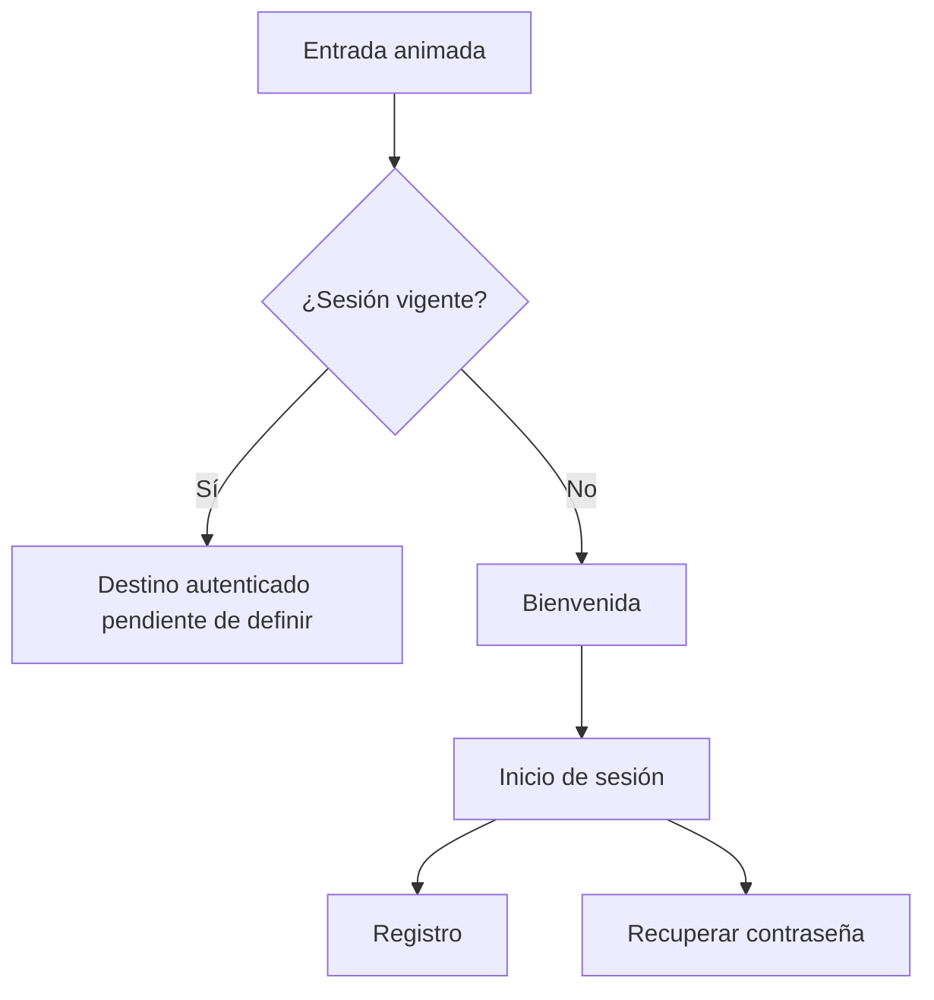

# Nerilum — vistas iniciales y animaciones

Versión 1.0 · 28 de septiembre de 2026  
Vistas incluidas: **entrada, bienvenida e inicio de sesión**. La ruta de registro se menciona únicamente como destino del enlace de acceso; su especificación detallada queda fuera de este documento.

## 1. Flujo de navegación

La pantalla de entrada es visual; la comprobación de sesión puede ejecutarse en paralelo. No mostrar un destino autenticado concreto hasta acordar el contenido del home. Si la comprobación requiere más tiempo que la animación, conservar un estado de carga accesible sin repetir indefinidamente la animación de marca.

## 2. Vista 01 — Entrada / splash

### Objetivo y composición

Presentar el isotipo **N** y el nombre **NERILUM** en un fondo `#0B0D0C`, con un brillo menta muy discreto. Mantener el centro visual despejado, respetar `SafeArea` y no mostrar botones obligatorios. El splash nativo del sistema operativo puede mostrar el logo estático; la secuencia siguiente ocurre en la primera pantalla Flutter.

### Secuencia propuesta

| Tramo | Duración orientativa | Movimiento |
| --- | --- | --- |
| Aparición | 0–250 ms | La N pasa de 0 a 100 % de opacidad con escala 0.96→1.0. |
| Revelado | 250–850 ms | La N se desliza suavemente a la izquierda; las letras `erilum` aparecen con máscara y opacidad. El resultado visible es «Nerilum». |
| Permanencia | 850–1200 ms | Marca completa, inmóvil, tiempo breve para leer. |
| Salida | 1200–1550 ms | Marca y fondo de brillo se desvanecen; transición a bienvenida o al destino de sesión. |

La duración total visual ronda **1.55 s**; no bloquear por ese tiempo la comprobación de sesión ni convertirlo en una espera artificial larga. Una interpolación suave como `easeOutCubic` evita un desplazamiento brusco. El texto debe ser real o semánticamente etiquetado como «Nerilum».

### Flutter

Un `AnimationController` único puede gobernar intervalos con `Interval` y `CurvedAnimation`; componer `FadeTransition`, `SlideTransition` y `ClipRect` para el revelado del texto. Ejecutar el controlador una sola vez en `initState`, comprobar `mounted` antes de navegar y liberar el controlador en `dispose`. Evitar una secuencia de `Future.delayed` anidados.

## 3. Vista 02 — Bienvenida

### Objetivo y contenido

Explicar la función en una primera lectura, con ilustración abstracta propia inspirada en capas de neuroimagen. La ilustración es decorativa: no equivale a una MRI clínica real.

- Título: **«Explora imágenes cerebrales»**.
- Descripción: **«Una herramienta académica de análisis orientativo.»**
- Acción primaria: **«Comenzar»** → inicio de sesión.
- Acción secundaria: **«Ya tengo cuenta»** → inicio de sesión (puede omitirse si ambas acciones duplican exactamente el mismo flujo; si se mantiene, «Comenzar» debe tener un destino distinto, como registro).

**Decisión de producto para implementar:** usar «Comenzar» → registro y «Ya tengo cuenta» → inicio de sesión. Así cada acción tiene un significado propio. Si se adopta acceso sin cuenta, habrá que redefinir estos destinos antes de codificar.

### Movimiento propuesto

| Elemento | Inicio | Efecto | Restricción |
| --- | --- | --- | --- |
| Título y descripción | Al entrar | Fade + 12 px de ascenso en 450 ms | Sin retrasar interacción. |
| Ilustración | Tras 100 ms | Fade de 550 ms y desplazamiento vertical de 8 px | Movimiento decorativo. |
| Botón | Tras 300 ms | Fade de 300 ms | Debe aceptar pulsaciones al quedar visible. |
| Fondo luminoso | Tras entrada | Oscilación muy leve, 4–6 s por ciclo | Puede desactivarse; nunca sobre el texto. |

Para transición desde splash, usar una disolvencia corta de 250–350 ms. No crear un carrusel obligatorio ni un vídeo. Las áreas de texto y acciones deben permanecer legibles sin la ilustración.

### Distribución adaptable

Título en la parte superior, arte en el centro y acciones en la parte inferior segura. En teléfonos bajos, permitir desplazamiento vertical o reducir el arte decorativo antes que comprimir texto y botones. El botón primario conserva al menos 52 px de altura.

## 4. Vista 03 — Inicio de sesión

### Estructura y textos

1. Isotipo y palabra **Nerilum** en versión reducida.
2. Título **«Iniciar sesión»** y apoyo **«Accede a tu cuenta»**.
3. Campos con etiquetas visibles: **«Correo electrónico»** y **«Contraseña»**.
4. Acción textual **«¿Olvidaste tu contraseña?»**.
5. Botón **«Ingresar»**.
6. Enlace **«¿No tienes cuenta? Regístrate»**.

Campos con teclado apropiado (`emailAddress` para correo), autocompletado, ocultación de contraseña con botón accesible y acción de envío desde el teclado. No mostrar una opción «continuar sin cuenta» hasta que el backend y la política de acceso la soporten.

### Estados del formulario

| Estado | Comportamiento |
| --- | --- |
| Vacío | Botón deshabilitado o validación clara al pulsar; etiquetas siempre visibles. |
| Error de formato | Mensaje junto al correo; conservar el texto ingresado. |
| Enviando | Botón en carga y un único envío activo; permitir volver sin dejar un estado bloqueado. |
| Credenciales incorrectas | Mensaje genérico y útil sin afirmar qué dato falló. |
| Red indisponible | Error diferente al de credenciales y opción de reintentar. |
| Éxito | Navegar al destino autenticado que se defina para el producto. |

La app de Flutter envía credenciales mediante HTTPS al backend de autenticación que se implemente; no almacenar contraseñas en texto plano ni registrar credenciales en logs. Los endpoints y el formato JSON deben ajustarse al contrato real del backend. Los enlaces de recuperación y registro deben tener rutas funcionales cuando se habiliten.

### Movimiento

Transición de entrada breve (fade de 250 ms, desplazamiento de 8 px). Los campos y el botón no necesitan animación escalonada prolongada. El foco, teclado, errores y estados de carga tienen prioridad sobre el adorno. Ajustar el contenido al teclado con `SafeArea` y desplazamiento si hace falta.

## 5. Accesibilidad y reducción de movimiento

- Si el sistema solicita reducir animaciones, mostrar el estado final estático de la marca y de la bienvenida y navegar sin efectos de desplazamiento o brillo repetitivo. En Flutter, verificar las preferencias de accesibilidad del entorno (`MediaQuery.disableAnimations` y las señales aplicables a la versión objetivo) antes de ejecutar cada animación decorativa.
- La animación nunca es el único medio para entender una acción, progreso o error.
- Proporcionar etiquetas semánticas para botones de mostrar/ocultar contraseña, logo y enlaces; marcar arte puramente decorativo como tal.
- Mantener contraste suficiente y comprobarlo en dispositivos reales; las cifras HEX del documento de estilo son propuestas, no una certificación automática de contraste.
- No asumir que la imagen de bienvenida es un dato médico analizado.

## 6. Criterios de aceptación de los mockups

- [ ] Las tres vistas usan los tokens de `Nerilum_Diseno_y_Estilo.md`.
- [ ] La secuencia de la N revela «Nerilum» y termina en una pantalla operable.
- [ ] Entrada y bienvenida tienen un estado estático equivalente cuando se reduce movimiento.
- [ ] Los botones de bienvenida conducen a destinos distintos y correctos.
- [ ] Login muestra estados de error, carga y éxito sin perder los datos de formulario.
- [ ] El teclado, las áreas seguras y el texto ampliado no ocultan acciones.
- [ ] No aparece todavía un home diseñado ni una afirmación de diagnóstico clínico.
